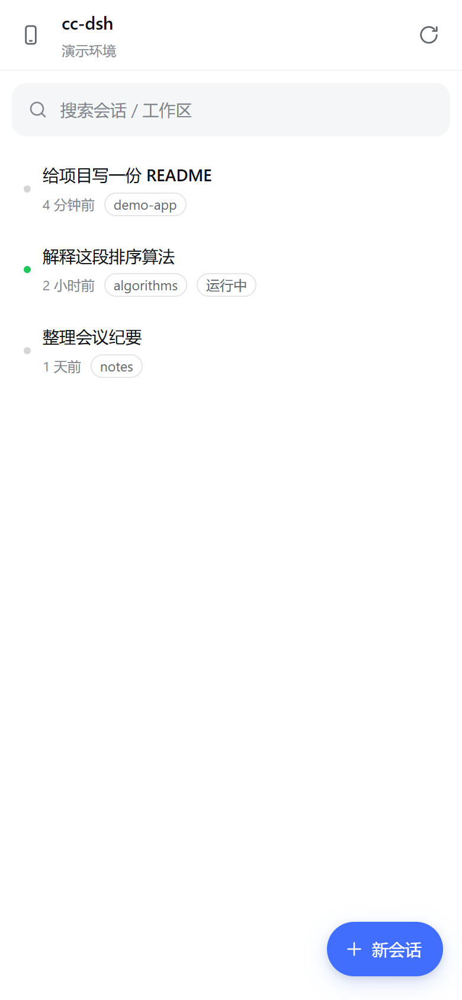
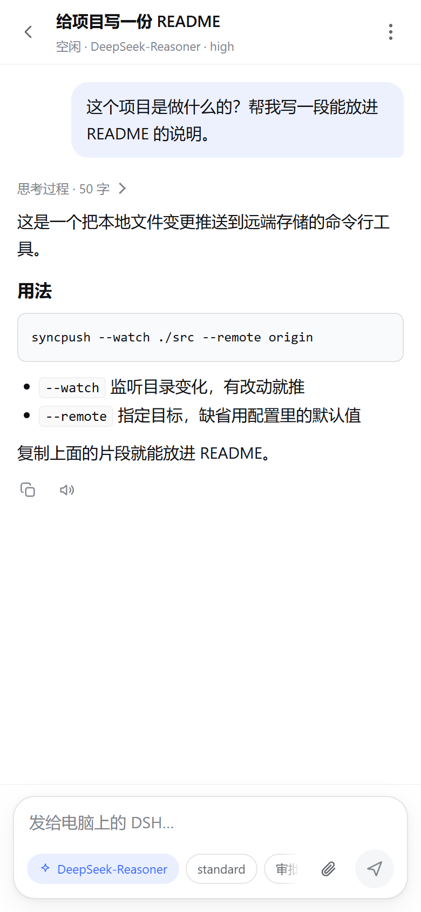
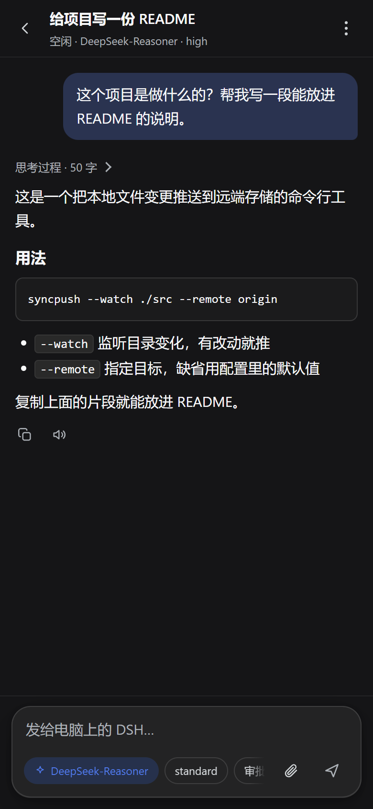

# dsh-PEC

<p align="center"><b>电脑上开着的 DeepSeek Harness，手机上接着用。</b></p>

**dsh-PEC 的手机端。** 装在电脑这边，手机通过局域网配对或 Tailscale 连进你的 DeepSeek Harness —— 看会话、接着聊、跑终端、管文件，进度实时同步。

手机连的是**你自己那台电脑上的 DeepSeek Harness**，不是某个云端服务：模型是你配的，文件在你硬盘上，不存在“两套状态”。

它由两部分组成：

- **dsh-PEC 插件**（包名 `dsh-pec`）：跑在电脑的 DSH 进程里，提供带鉴权的手机网关 + 一个手机版网页界面；
- **dsh-PEC APK**：约 25 KB 的原生外壳，只负责配对、保存信任、承载界面。

> 本项目在 **DSH desktop 0.2.1-rc.5** 上开发并验证；DSH 的 Host 服务签名若发生大的变化，插件需要相应调整。

---

## 界面

<p>
  
  
  
</p>

主题跟随 DSH「设置 → 通用 → 外观 / 字体大小」，浅色与深色都是同一套设计令牌。

## 功能

### 会话与对话

- 列表、搜索、运行状态、子代理会话过滤、新建 / 重命名 / 归档；新建会落在真实工作区里，不会掉进 DSH 的 profile 目录。
- 完整历史、逐字流式输出、思考过程折叠、工具调用折叠卡片；回答按 Markdown 渲染（代码块 / 行内代码 / 列表），下方可复制、朗读。
- **加载更早**：历史再长也能往回翻，翻页时阅读位置不动，断流重连不会把已翻出来的旧消息冲掉。
- 发出去的图片直接显示成气泡；每轮回答左下角有「本轮用时 · token 用量 · 缓存命中率」，口径与电脑端一致。
- **运行中追加**：回答还在跑时输入下一句，点发送会排队排到当前步骤之后，不会打断这一轮；清空输入框后按钮才变成「停止」，也可以长按发送键随时停止。
- **会话统计条**：输入框下方显示桌面同款数据——轮 / 步、tok/s、总 tok、缓存命中率、上下文占用；任务清单与进行中的目标实时显示在输入框上方。
- 输入框草稿按会话保存：切走、返回列表、刷新页面，写到一半的话都还在。
- **任务与目标状态栏**：输入框上方实时显示任务完成 / 进行中 / 待处理数量，点击展开清单；目标显示当前状态、内容和轮次，点击进入详情。打开或重连会话时自动恢复，新一轮开始后清空上一轮任务。

### 不用回电脑也能操作

- **模型与推理等级**：按供应商分组的全部可路由模型，切换即写入该会话；每个模型下方直接选推理等级（off / low / medium / high / max）。
- **模式与权限**：Agent 预设（standard / ptc / minimal / cordis…）；只读 / 仅工作区 / 完全访问，直接改该会话的沙箱与审批策略。
- **审批与提问**：「接管 30 分钟」期间，工具调用推到手机，可允许 / 拒绝；`ask_user_question` 的选择框在手机上原样出现（单选 / 多选 / 自定义回答 / 跳过），不再只能在电脑上点。两档接管：安全模式（电脑端在线时交给电脑，不留残窗）与强制模式（人在外面时用）。
- **终端**：真 PTY + xterm.js 渲染：彩色、光标、行编辑、Ctrl-C / Tab / 方向键，支持全屏 TUI；无 PTY 时自动降级为持久 shell。
- **文件**：按会话工作目录浏览，点文件看文本（>2 MB 或二进制拒绝）。
- **设置**：读取并可改 DSH 各设置组里的 volatile 字段；**模型供应商**可在手机上新增 / 编辑 / 删除，新增时填好地址和密钥后可**一键获取该端点的模型列表**（与桌面「获取模型」同源），勾选后创建。
- **目标与计划任务**：看目标、阶段、轮次，暂停 / 继续 / 完成 / 清除；提醒可新建、删除。
- **插件**：列出可开关的插件，开关即时生效。

### 连接

- 两种连法：同一 Wi-Fi 下局域网直连（可自动查找），或两边都上 Tailscale 走 `100.x.y.z:7317`。
- 首次配对免码（仅限私有网段），之后加设备必须输入电脑上显示的 6 位配对码；设备凭据可在电脑端随时移除。

## 安全模型

手机拿到的是**电脑的执行权**，所以这里的每一条都是硬的：

- 每台手机一个 32 字节随机设备令牌，电脑上只存 SHA-256；
- 首次配对仅接受**私有地址**（10/8、172.16/12、192.168/16、100.64/10、回环）；
- 配对码 6 位、10 分钟轮换、一次有效，仅存内存；
- 回环请求视为电脑所有者，用于设置页读取配对码 / 重命名设备；
- 设备令牌可在「手机连接」里随时移除；
- 局域网内是明文 HTTP：请在个人 Wi-Fi 或 Tailscale 内使用，不要走公共 Wi-Fi；
- 不建议把 7317 端口映射到公网。

## 架构

```
┌──────────────────┐        HTTP + SSE         ┌──────────────────────────────┐
│  dsh-PEC APK    │  ───────────────────────▶ │  dsh-PEC 插件（DSH 进程内）  │
│  WebView + 配对    │                           │                              │
└──────────────────┘                           │  sessionController  会话/模型 │
                                               │  agentPresets       预设      │
                                               │  permissionPresets  权限      │
                                               │  pluginManager      插件      │
                                               │  settings           设置      │
                                               │  fs / subprocess    文件/命令 │
                                               │  goals / schedule   目标/提醒 │
                                               └──────────────────────────────┘
```

手机只跟插件通信；插件以进程内 owner 身份调用 DSH 的 Host 服务，因此不需要反向解析 DSH 的私有协议，也不用第二套后端。

## 下载与安装

到 [**Releases**](https://github.com/huajikano/dsh-PEC/releases) 下载两个文件：

| 文件 | 用途 |
| --- | --- |
| `cc-dsh-plugin-<版本>.zip` | DSH 插件。解压得到 `plugin-ccdsh/`，在 DSH 里「安装本地目录」指向它 |
| `dsh-pec-<版本>.apk` | Android 手机端（约 25 KB） |

插件安装步骤（含校验、端口确认、卸载）见 **[docs/INSTALL-plugin.md](docs/INSTALL-plugin.md)**。

### 1. 安装插件

三种方式任选其一，**推荐前两种**：

- 下载 Release 里的 `cc-dsh-plugin-<版本>.zip`，解压得到 `plugin-ccdsh/`，用插件管理界面「安装本地目录」选中它（本地目录不受 pnpm 锁文件影响，最稳）；
- `dsh plugin add dsh-pec`（发布到 npm 后可用，版本不可变，最不容易出问题）；
- 从 GitHub 装：`dsh plugin add huajikano/dsh-PEC#v2.0.0` —— **一定要带 `#tag`**。

> **从 1.x 升级到 2.0.0**：2.0.0 把包名从 `cc-dsh` 改成了 `dsh-pec`（和仓库同名）。包名就是 DSH 里的插件身份，所以这是一次破坏性迁移：先卸载旧的 `cc-dsh`，再装新的 `dsh-pec`。配对记录会自动从 `%DSH_HOME%\cc-dsh\` 复制到 `%DSH_HOME%\dsh-pec\`，手机不用重新配对。
>
> 为什么不建议直接填 `huajikano/dsh-PEC`：pnpm 会把 GitHub 生成的 tarball 哈希写进 profile 的 `pnpm-lock.yaml`，而主分支一动（我们每次发版都会动），同一个 `github:` 来源的内容就变了。pnpm 在安装/更新时**会校验锁文件里所有 git 来源的包**，任何一个哈希对不上就整体失败，报 `ERR_PNPM_TARBALL_INTEGRITY`——表现就是"所有插件都装不上/更新不了"。钉到 tag 就不会漂移。

已经撞上这个错的话，修法见 [docs/INSTALL-plugin.md](docs/INSTALL-plugin.md#pnpm-锁文件报-tarball-integrity-错误)。

安装后插件会监听 `0.0.0.0:7317`（端口被占用时自动换随机端口，日志里会打印实际地址）。

### 2. 安装 APK

- 下载 Release 里的 `dsh-pec-<版本>.apk`；或
- 自行构建（见下文「自行构建」），产物在 `dist/cc-dsh.apk`（构建脚本沿用旧文件名）。

> 2.0.0 只改了 APK 的**显示名**（应用名 `dsh-PEC`），包名仍是 `com.ccdsh.app`，所以能覆盖安装，配对不会丢。

### 3. 配对

1. 打开 App，点「在同一 Wi-Fi 下自动查找」，或直接填 `电脑IP:7317`；
2. **第一次配对码留空**，点「连接」。

> 首次免码是有意设计：此时电脑上还没有任何已配对设备，没有可保护的对象，而手机本来就在同一网段。配对成功后，再加第二台手机就必须输入电脑上显示的 6 位配对码。

### 4. 之后添加手机 / 换手机

电脑端：DSH **设置 → 手机连接**，可以看到 6 位配对码、局域网 / Tailscale 地址、已配对设备（含平台与配对时间，可重命名、移除）。

## 异地使用（不在家）

用 **Tailscale** 把手机和电脑放进同一个私有网络，然后用电脑的 `100.x.y.z:7317` 访问。完整步骤（含 Windows 防火墙、常见故障）见 **[docs/tailscale.md](docs/tailscale.md)**。

## 已知限制

1. **终端**：手机端用 xterm.js 1:1 渲染原始字节流（包括 ANSI 颜色、光标定位、全屏程序）。PTY 走 `subprocess.spawnTerminal`（ConPTY / pty）；只有当这个环境根本不提供 PTY 时才降级为「持久 shell」（保留状态，但没有全屏 TUI），再退一步才是逐条命令模式。
2. **审批接管有两档**：安全模式在电脑端页面在线时不抢请求（避免电脑上留下点不掉的弹窗）；强制模式即使电脑在线也由手机决定，代价是电脑端可能留一个待处理弹窗。人在外面用强制模式，回到电脑前记得处理掉。
3. **设置只开放 volatile 字段**：布尔 / 数字 / 字符串 / 枚举，嵌套对象与需要重启的项不在这里改。
4. 文件只能在线预览文本，没有下载到手机；暂不支持把手机文件上传到电脑（图片除外）。

## DSH 升级兼容性

插件直接调用 Harness 的 Host 服务，所以 Harness 升级后请先看一眼自检：

```powershell
curl.exe -sS http://127.0.0.1:7317/api/health
```

- `ok: true` 且 `missing: []` → 一切正常；
- `missing` 里列出的是缺失的服务/方法，插件会**只禁用相关功能**，不会连带影响 DSH 其它部分；
- 手机端列表页也会显示同样的提示条。

设计上是抗升级的：激活全程 try/catch（插件坏了不会拖垮整个 profile）、启动时探测能力、接口出错返回 503 并附带缺失项、设置面板与手机端都有渲染兜底。详细说明见 [docs/compat.md](docs/compat.md)。

> 从 0.2.1 升到 0.2.2 时出现过"整个 DSH 会话不可用"的情况，源头是 profile 里同时存在 `@deepseek-ai/dsh-experimental-terminal-bundle` 与 0.2.2 内置的可选终端行，终端注册表重复。插件本身不依赖这个 bundle（终端走基础服务 `subprocess`），可以安全移除。

## 目录结构

```
（本仓库根目录就是插件本体）
  index.js              入口：启动网关、注册清理
  lib/gateway.js        HTTP 路由 / SSE / 鉴权 / 局域网发现 / 静态资源
  lib/state.js          设备令牌、配对码（内存）、原子持久化
  lib/dsh.js            DSH Host 服务适配层
  lib/approvals.js      审批接管
  web/                  手机界面（无构建步骤的 HTML/CSS/JS）
  client.js             DSH「设置 → 手机连接」面板
  cordis.patch.yml      dsh.bundle 清单
android-shell/          Android 外壳（原生 Java，无 Gradle）
  app/src/main/...      WebView、配对、SSL 固定、文件选择、下载
  build-apk.ps1         直接调用 aapt2 / javac / d8 / apksigner 的构建脚本
docs/tailscale.md       电脑版 + 手机版 Tailscale 安装与使用
```

## HTTP API 速查

所有 `/api/*`（除 `ping`、`pair`）都需要设备令牌或来自回环。

```
GET  /api/ping                     健康检查
POST /api/pair                     { code?, name, platform?, userAgent? } → { token, deviceName }
GET  /api/bootstrap                会话 / 模型 / 预设 / 工作区 / 权限 / 插件 / 待审批
POST /api/sessions                 { workspaceId? | cwd?, preset? } → { sessionId }
GET  /api/sessions/:id/stream      SSE：snapshot → event… → assistant-stream…
POST /api/sessions/:id/prompt      { text, mode?: 'queue'|'steer', images?: [...] }
POST /api/sessions/:id/cancel | rename | model | preset | permission
GET  /api/files?session=&path=     目录列表
GET  /api/files/read?session=&path=
GET  /api/runs?session=            最近命令
POST /api/runs                     { session, command } → { id }
GET  /api/runs/:id?cursor=         增量输出
POST /api/runs/:id/kill
GET  /api/settings                 设置组 + 字段
POST /api/settings/:ns             { patch, revision }
GET  /api/goal?session= ; POST /api/goal/:action
GET  /api/schedules ; POST /api/schedules ; POST /api/schedules/delete
GET  /api/plugins ; POST /api/plugins/:entryId/toggle
POST /api/approvals/arm ; POST /api/approvals/:id
GET  /api/server                   地址 / 设备 / 配对码（仅回环）
```

## 第三方组件

- [xterm.js](https://xtermjs.org/) 5.5.0 与 `@xterm/addon-fit` 0.10.0（MIT），随插件放在 `web/vendor/`，许可证一并附带。

## 自行构建

插件是纯 ESM，**不需要构建**，装进 profile 即可。

APK 用仓库自带的脚本构建，不依赖 Gradle / Flutter / 网络：

```powershell
# 需要：Android SDK（build-tools + platforms;android-36）与 JDK 17+
pwsh ./android-shell/build-apk.ps1

# 自定义位置
pwsh ./android-shell/build-apk.ps1 -AndroidSdk C:\Android\sdk -JavaHome "C:\Program Files\Java\jdk-21"
```

脚本会在 `build-keys/ccdsh.keystore` 生成签名密钥（已 gitignore）。**请保留它**：换一个密钥签名的 APK 无法覆盖安装。

## License

MIT，见 [LICENSE](LICENSE)。

---

## English summary

**dsh-PEC** lets an Android phone drive DeepSeek Harness running on your PC. A small DSH plugin
hosts an authenticated HTTP/SSE gateway and a mobile web UI; a ~25 KB native APK provides pairing,
trust storage and a WebView shell. Because the plugin calls DSH's own Host services in-process,
sessions, models, presets, permissions, files, commands and settings stay consistent with the
desktop app. Pair the first phone with no code while on a private network; later phones use a
rotating 6-digit code shown in **Settings → Phone**. For remote use, put both devices on
[Tailscale](docs/tailscale.md) and open `http://<tailscale-ip>:7317`.
